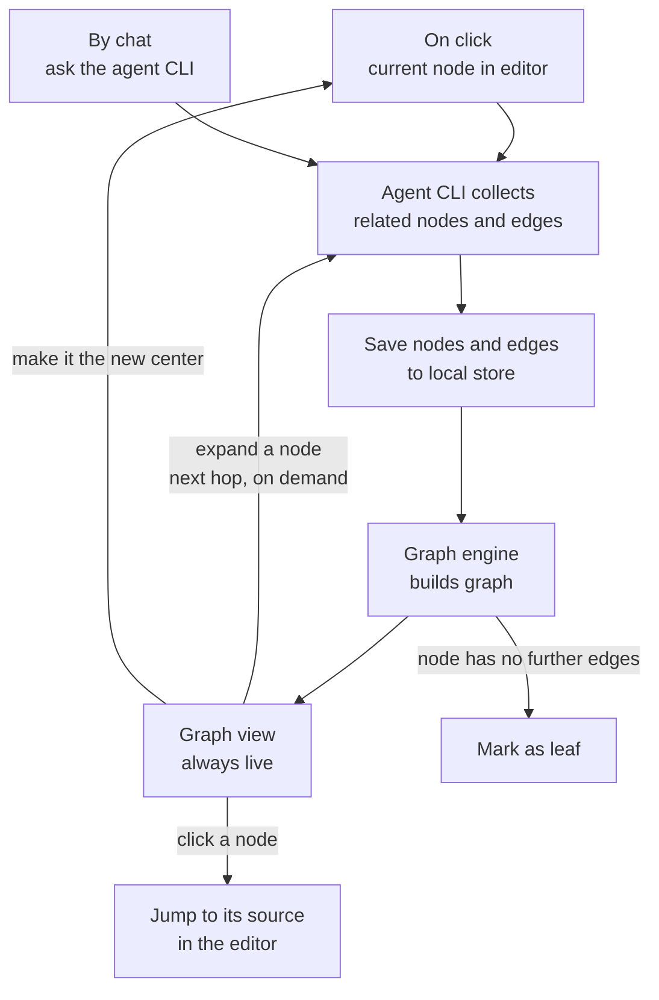

# Sketch

## Some thoughts

- I think one giant code-graph is NOT practical: it gets too big to read and too slow to build. Small, focused sub-graphs around what I'm working on are more useful.

- Some graph tools using AST like tree-sitter only see syntax, so they miss real links (types, overloads, imports across files). LSP gives more accurate edges.

- I mean a code graph is not enough. Next to it, or before it, there must be a doc graph: the specs, designs and notes that explain why the code exists.

- Meaning I think there are many layers for building a comprehensive view: code layer, doc layer, and the links between them. Each graph can be explored on its own or together.

- The architect of the codebase must be able to add new features in the future without changing the core.

## Features

### Feature 1 - Graph view

- Ego Graph: a focused view of one node and its direct neighbors.

- Multi-hop: expand from the center hop by hop, until leaf nodes.

- Code + Docs: one graph mixing code edges (calls, references, imports) and doc edges (links, headings).

- Local Store: cache nodes and edges per file version on disk, so reopening the graph is instant and works offline.

- Not a giant graph, but able to handle multiple sub-graphs, and we can perform operations like create, update, delete, merge and link sub-graphs together.

- Click to Navigate: click a node to jump to its source in the editor.

- On-demand Graph: the graph viz engine only draws, and the events that trigger a draw are separate. A graph can be drawn when I click something in the editor, or when I ask the agent coding CLI, which calls the extension to visualize the result.

## Workflow

One graph engine, two ways to trigger it:

- On click: pick the current node in the editor (the symbol under the cursor, or a heading).

- By chat: ask the agent coding CLI, e.g. "show how this doc relates to the code".

Both go through the same steps:

- The agent coding CLI collects the related nodes and edges and writes them to the local store. In the future it can use AST and LSP tools to get exact edges (definitions, references, calls) instead of heuristics.

- The graph engine builds the graph from the store and shows it in the graph view.

- Expand a node to get the next hop, on demand, until you reach leaf nodes.

- Click a node to jump to its source.

