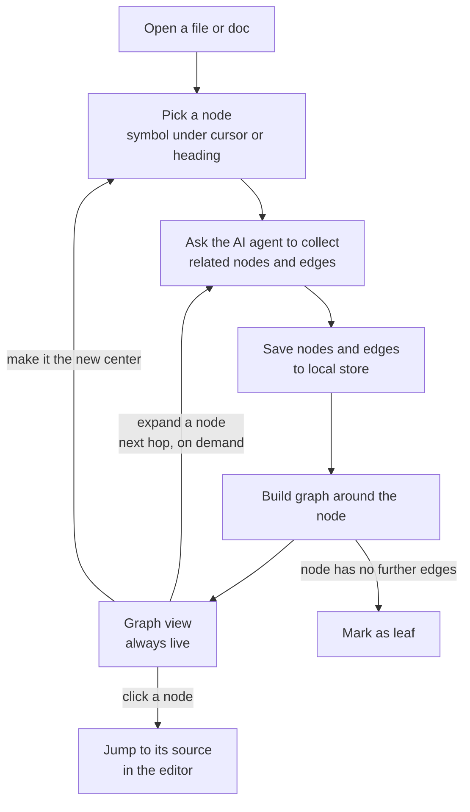

# Sketch

## Some thoughts

- I think one giant code-graph is NOT practical: it gets too big to read and too slow to build. Small, focused sub-graphs around what I'm working on are more useful.

- Some graph tools using AST like tree-sitter only see syntax, so they miss real links (types, overloads, imports across files). LSP gives more accurate edges.

- I mean a code graph is not enough. Next to it, or before it, there must be a doc graph: the specs, designs and notes that explain why the code exists.

- Meaning I think there are many layers for building a comprehensive view: code layer, doc layer, and the links between them. Each graph can be explored on its own or together.

- The architect of the codebase must be able to add new features in the future without changing the core.

## Features

### Feature 1 - Graph view

- Ego Graph: a focused view of one node and its direct neighbors.

- Multi-hop: expand from the center hop by hop, until leaf nodes.

- Code + Docs: one graph mixing code edges (calls, references, imports) and doc edges (links, headings).

- Local Store: cache nodes and edges per file version on disk, so reopening the graph is instant and works offline.

- Not a giant graph, but able to handle multiple sub-graphs, and we can perform operations like create, update, delete, merge and link sub-graphs together.

- Click to Navigate: click a node to jump to its source in the editor.

## Workflow

### Simple workflow

- Open a file or doc and pick a center node (the symbol under the cursor, or a heading).

- Currently we rely on an agent coding CLI to perform the analysis: it reads the code and docs, then writes the nodes and edges to the local store.

- In the future we can use AST and LSP tools that the agent coding CLI can use to get exact edges (definitions, references, calls) instead of heuristics.

- Expand hop by hop to follow calls, references, imports and doc links, until you reach leaf nodes.

- Click a node to jump to its source.

